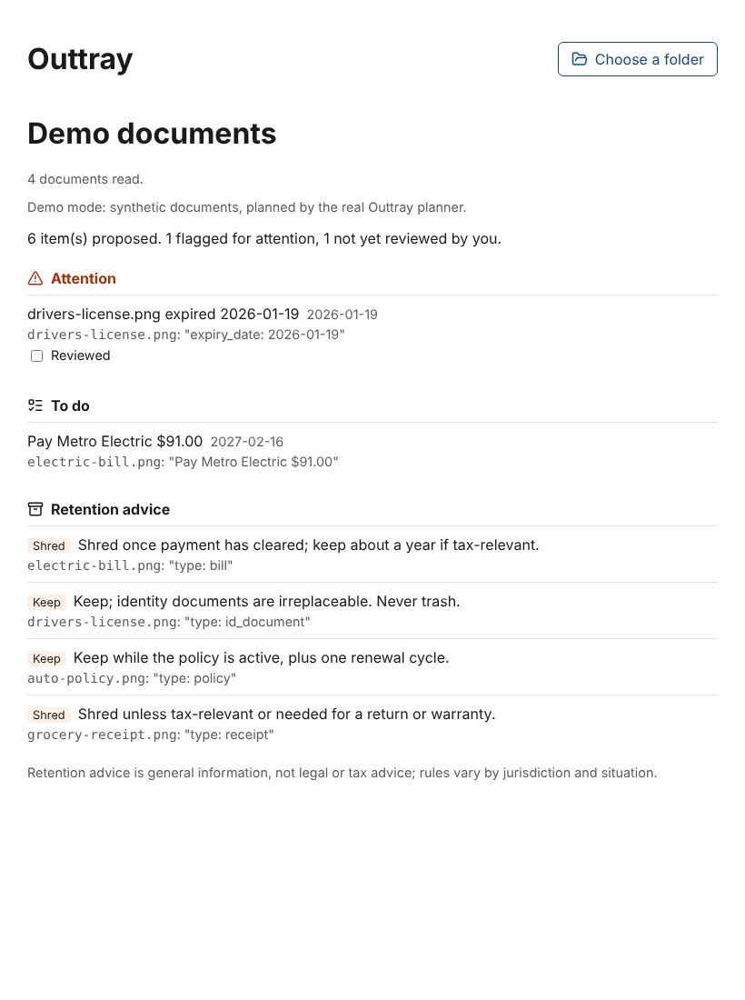

# @outtray/app

The desktop app's UI (Phase 3). React over the host-neutral `@outtray/core`
(ADR-0013): the UI depends only on the `OuttrayApi` interface in `src/api.ts`.

Today `OuttrayApi` is backed by `src/demo-api.ts`, which runs the real core
planner in the page over synthetic documents. The Tauri shell and its Rust
adapters (storage over rusqlite, the native Keychain key, Tauri file access)
replace it in the next slices.

```sh
pnpm --filter @outtray/app dev      # local preview of the demo (stop it when done)
pnpm --filter @outtray/app bundle   # production bundle into dist/web
```

The queue follows ADR-0008: every proposal shows the evidence it came from,
review-gated items say so, the retention disclaimer is always shown, the
summary never claims an all clear, and nothing in the UI acts on a file.


